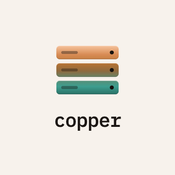

<p align="center">
  <picture>
    <source media="(prefers-color-scheme: dark)" srcset=".github/assets/copper-logo-dark.png">
    
  </picture>
</p>

An Oxide inspired mini cloud for a couple of home machines. Rust, plain systemd daemons.

- `kiln/`   the control plane: SQLite source of truth, placement, user API
- `ingot/`  the node agent: runs on every compute node, reconciles libvirt toward desired state
- `cu/`     the command line client
- `api/`    wire types shared by all three

See `docs/design.md` for the decisions so far and `docs/roadmap.md` for what comes next.

## Install

One machine runs kiln. Name it `kiln` on your tailnet so every node finds it by default. The installer also adds Ubuntu 24.04 to kiln's image catalogue, which nodes download from by hash. The tailnet is copper's network: kiln listens on it, nodes and people reach kiln over it, and VMs live on copper's own `10.42.0.0/16`, a /24 per node, rather than on any site's LAN. That works the same whether a node sits on your home router or anywhere else.

```sh
curl -fsSL https://raw.githubusercontent.com/Shreyas220/copper/main/install.sh | sudo sh -s -- kiln
sudo -u copper kiln --db /var/lib/copper/kiln.db token --user you --role admin
```

Every compute node runs ingot. It needs libvirt, `qemu-utils` and `cloud-image-utils`, but no local images.

```sh
curl -fsSL https://raw.githubusercontent.com/Shreyas220/copper/main/install.sh | sudo sh -s -- ingot
```

An Apple silicon Mac becomes a node with Tart instead of libvirt. Run this as the user that stays logged in; it installs Homebrew, Tart, QEMU and ingot as a LaunchAgent. Re-run it with `--update` to upgrade. The Tart backend is a preview and has not yet run on a real Mac.

```sh
curl -fsSL https://raw.githubusercontent.com/Shreyas220/copper/main/dist/macos/prepare.sh | sh -s -- --kiln http://kiln:8400
```

Mac guests are arm64, so give kiln an arm64 image once, on the kiln machine:

```sh
curl -fsSL https://raw.githubusercontent.com/Shreyas220/copper/main/install.sh | sudo sh -s -- kiln --image-arch aarch64
```

Then approve the node and make a VM:

```sh
export CU_URL=http://kiln:8400 CU_TOKEN=cu_...
cu node ls && cu node approve <id>
cu project create default
cu key add                         # save ~/.ssh/id_ed25519.pub, or `cu key new` to make a key
cu create web --vcpus 2 --memory 2048
cu ls
cu ssh web                         # through kiln and the VM's node, from anywhere
cu forward web 8080                # its port 8080 at localhost:8080
cu ssh-config web >> ~/.ssh/config # then: scp file web.copper:
cu stop web --wait && cu resize web --memory 4096 --disk 20 && cu start web
cu log web                         # what happened to it, newest first
cu node set <id> --cpu-ratio 4     # admin: let 8 threads back 32 vCPUs
```

`install.sh --help` lists the options, including `--binaries target/release` to install a local build.

## Console

Kiln serves a web console on the same address as its API: `http://kiln:8400`. Nobody signs up; an admin sends invite links from the console. The first admin's link comes from the kiln machine:

```sh
sudo -u copper kiln --db /var/lib/copper/kiln.db invite --user you --role admin --url http://kiln:8400
```

The console shows instances with their history, live metrics and a serial console, plus nodes, images, quotas, users and tokens. `cu` keeps using tokens.
